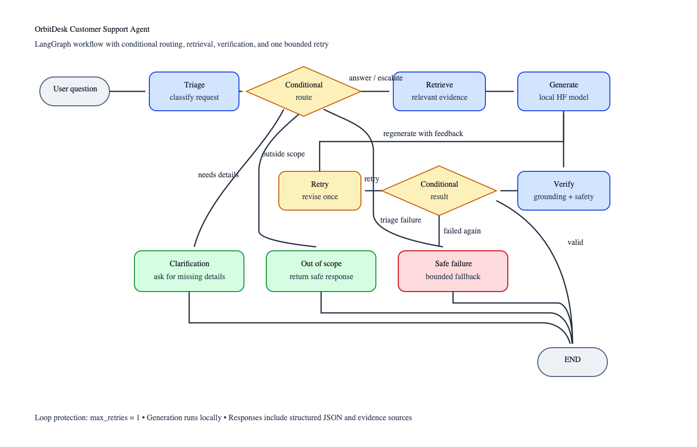
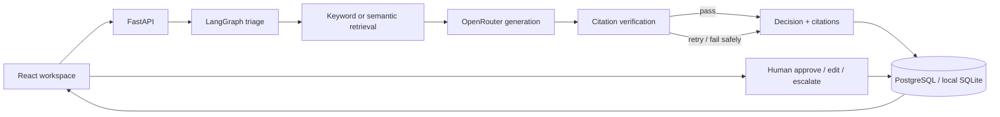

# OrbitDesk Customer Support Agent

OrbitDesk is a portfolio-grade, retrieval-grounded support workspace for a **fictional** SaaS product. A customer question becomes a saved ticket; the agent retrieves current product evidence, drafts an answer or escalation, verifies its citations, and leaves a human reviewer in control. The knowledge base, resolved cases, questions, and recorded demo answers are synthetic. Nothing is sent to a real customer.



## What the product does

- LangGraph routes a question through triage, retrieval, generation, citation verification, one bounded retry, and safe failure. The default retriever is lightweight keyword search; semantic search is an optional local extra.
- FastAPI stores tickets, normalized decisions, citation metadata, and reviewer actions in SQLAlchemy tables. PostgreSQL is the Compose database; Alembic owns its schema. A separate SQLite database is convenient for local development.
- React shows persisted ticket history, the generated answer, why the agent escalated or asked for clarification, full source documents, a redacted trace, and approve/edit/escalate controls. No uncalibrated confidence percentage is shown to reviewers.
- A fixed 30-case synthetic quality set checks routing and answer behavior. Saved experiment JSON makes retrieval versions comparable on the same dataset.



Knowledge-base documents are authoritative; resolved cases are secondary, and superseded cases are excluded from retrieval. A citation records its source ID, title, type, exact passage, and optional answer-claim link. Exact-passage verification is useful but **does not prove that every claim follows from the cited text**.

## Run locally

Requires Python 3.11+, Node.js 22+, and npm.

```bash
python3 -m venv .venv
source .venv/bin/activate
python -m pip install -e '.[dev]'
cd frontend && npm ci && cd ..
```

For a keyless recorded demo, start the API and frontend in separate terminals:

```bash
ORBITDESK_DEMO_MODE=1 .venv/bin/orbitdesk-api
```

```bash
cd frontend && npm run dev
```

Open the URL printed by Vite (normally `http://127.0.0.1:5173`); the reader-facing OrbitDesk product guide is at `/docs/`, while the support service's API reference is at `http://127.0.0.1:8000/api/docs`. Do not open `frontend/index.html` directly as a `file://` page: the React chatbot needs the Vite server. The guide summarizes the checked-in Markdown knowledge base; the JSON files hold demo questions, recordings, and evaluation data. The five selectable answers are recordings, not fresh model generations. The default local database is `artifacts/orbitdesk-v2.sqlite3`. An older `artifacts/tickets.sqlite3` file, if present, is left untouched because its opaque-JSON schema is incompatible; point to a new database or migrate it separately after backing it up.

For live questions, export `OPENROUTER_API_KEY` in the API shell and leave `ORBITDESK_DEMO_MODE` unset. The `.env` file is **not** automatically loaded by the Python app. Live calls may cost provider credits. `OPENROUTER_MODEL` defaults to `z-ai/glm-4.5-air`. The browser never receives the key. The output cap now defaults to 768 tokens; if an older local `.env` or shell pins `ORBITDESK_MAX_OUTPUT_TOKENS=256`, update that setting, since the smaller cap truncated live JSON in testing.

### PostgreSQL demo with Docker Compose

```bash
export ORBITDESK_POSTGRES_PASSWORD='a-local-only-password'
docker compose up --build
```

Open `http://127.0.0.1:8000`. Compose builds the frontend, starts PostgreSQL, runs `alembic upgrade head` before the API, and retains tickets in a named volume. The container is bound to localhost; it is **not** an authenticated public deployment. This path was verified end to end on October 9, 2026: both containers became healthy, unauthenticated ticket access returned `401`, an authenticated ticket returned `201`, and the ticket remained available after restarting the API container.

For a private demo access gate, also set `ORBITDESK_OPERATOR_TOKEN` (24+ random characters recommended) before starting Compose. The browser then asks for that token; it keeps it only in memory and sends it in `X-OrbitDesk-Token`, never in a URL. Health and recorded question labels remain public; ticket, source, review, and model endpoints require the token. This is a **shared operator secret**, not per-user accounts or a substitute for HTTPS and a real identity provider.

For a separate PostgreSQL installation, set `ORBITDESK_DATABASE_URL=postgresql+psycopg://...`, run `alembic upgrade head`, then start the API. In `ORBITDESK_ENV=production`, startup requires a PostgreSQL URL, `OPENROUTER_API_KEY`, `ORBITDESK_ALLOWED_ORIGINS`, a 24+ character operator token, and a positive `ORBITDESK_RETENTION_DAYS`; it rejects recorded demo mode. Put HTTPS and rate limiting in front before public exposure.

Retention is deliberately not automatic. The command previews reviewed tickets older than the policy; `--apply` deletes them and their decisions, citations, and reviews. Pending tickets are never selected. Back up the database and schedule the command yourself only after reviewing its dry-run count:

```bash
ORBITDESK_RETENTION_DAYS=30 .venv/bin/orbitdesk-retention
ORBITDESK_RETENTION_DAYS=30 .venv/bin/orbitdesk-retention --apply
```

See [.env.example](.env.example) for timeouts, CORS, retrieval, and other configuration. Do not commit keys or real customer data.

## Quality evaluation and actual results

`answer_eval.json` fixes 30 questions spanning supported facts, ambiguous requests, missing policy, out-of-scope requests, historical cases, citation checks, and escalation. Of these, 23 carry an expected source for retrieval scoring; seven are intentionally source-free. Retrieval metrics are HitRate@K and MRR. Answer checks use classification/action, required facts, reason codes, human-review flags, required citations, exact excerpt verification, and selected forbidden terms. “Grounded” and “unsupported” are **citation/keyword proxies**, not semantic entailment measurements or human judgments.

Measured from actual runs on the checked-in dataset:

| Experiment | Retrieval cases | Hit@K | MRR | Saved answers evaluated | Answer checks passed |
| --- | ---: | ---: | ---: | ---: | ---: |
| [keyword-k1](evaluation_results/keyword-k1.json) | 23 | 6/23 (26.1%) | 0.261 | 5/30 | 5/5 |
| [keyword-k3](evaluation_results/keyword-k3.json) | 23 | 22/23 (95.7%) | 0.558 | 5/30 | 5/5 |
| [keyword-k4](evaluation_results/keyword-k4.json) | 23 | 22/23 (95.7%) | 0.558 | 5/30 | 5/5 |
| [keyword-k4-v2](evaluation_results/keyword-k4-v2.json) | 23 | 23/23 (100%) | 0.623 | 5/30 | 5/5 |
| [live-keyword-v2](evaluation_results/live-keyword-v2.json) | 23 | 23/23 (100%) | 0.623 | 30/30 | 12/30 |

The five recorded outputs include **two answerable questions and one expected escalation**; those small-sample ratios are not evidence of broad model quality. The live run used `z-ai/glm-4.5-air` and a 768-token output cap. It produced 30 valid responses: **7/19** answerable fact checks passed, **9/9** answered responses passed the citation-grounded proxy, and **0/9** triggered the unsupported-answer proxy. Escalation precision was **2/3** and recall **2/6**. Eleven responses safely failed citation verification; they did not fabricate an answer, but they still failed the intended task. Manual inspection found repeated verification failures on supported questions (for example Q-002 and Q-004), an unnecessary escalation on Q-019, and an insufficient-evidence question (Q-025) routed as an answerable refusal instead of escalation. The “grounded” proxy only scores the nine responses that actually answered and cannot establish semantic entailment.

The [live failure taxonomy](docs/live-failure-taxonomy.md) accounts for all 18 failed cases and defines the fixed-input contract for the next live run.

The v2 keyword scorer rewards coverage of the whole query, moving the Viewer-download policy source (Q-008) into the top four. The old experiment files are retained as baselines. Changing retrieval K in the recorded-output comparison does not regenerate the five answers, so those answer columns remain identical by design.

```bash
.venv/bin/orbitdesk-experiment --experiment keyword-k4-v2 --retrieval keyword --top-k 4
.venv/bin/orbitdesk-experiment --compare evaluation_results/keyword-k4.json evaluation_results/keyword-k4-v2.json
.venv/bin/orbitdesk-evaluate-answers --labels answer_eval.json --outputs sample_outputs.json
```

To generate and score all 30 questions against OpenRouter (provider key and credits required), run:

```bash
OPENROUTER_API_KEY='your-key' .venv/bin/orbitdesk-experiment --experiment another-live-run --retrieval keyword --top-k 4 --live
```

The live runner saves each output incrementally, recording per-case failures rather than inventing answers, then writes a versioned JSON report. It enforces the workflow’s fixed K=4. For semantic retrieval, install `.[semantic]` first. Compare only reports with the same dataset hash. Review failures and generated outputs manually before citing live quality claims.

## Tests and reliability

```bash
.venv/bin/pytest -q
cd frontend && npm test && npm run build
```

OpenRouter requests have configurable per-attempt and total deadlines, bounded retries, input/output limits, and a response-size cap. The graph checks exact citation excerpts and rejects superseded evidence; provider or verification failure produces a safe failure, not an invented fallback. Traces omit prompts, questions, and credentials. Tests cover routing, missing evidence, malformed citations, provider failures, persistence, review conflicts, experiment math, and API behavior.

For a short product demo and known limitations, see [the portfolio walkthrough](docs/portfolio-walkthrough.md). The project is MIT licensed.
